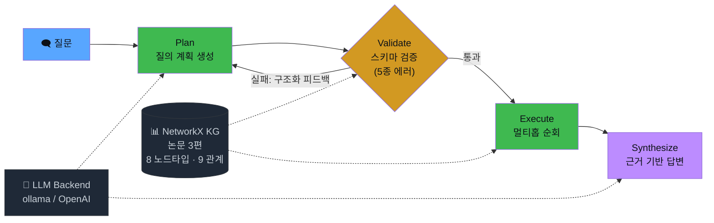
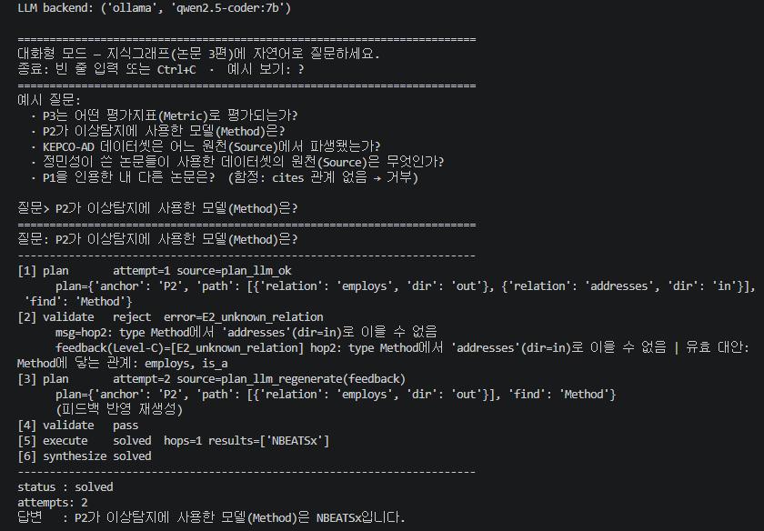
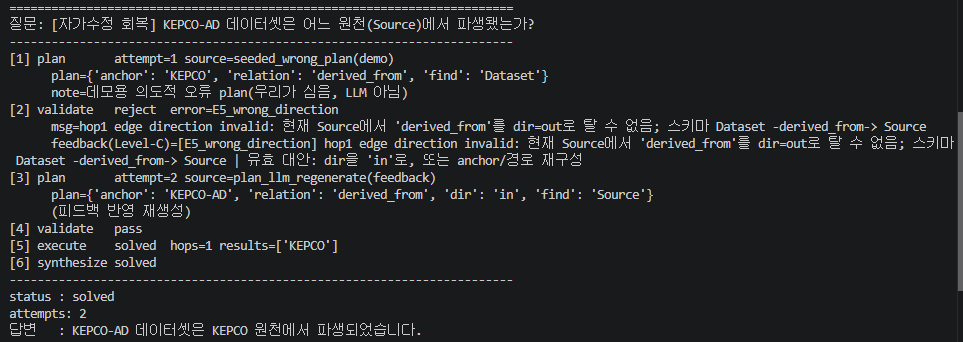
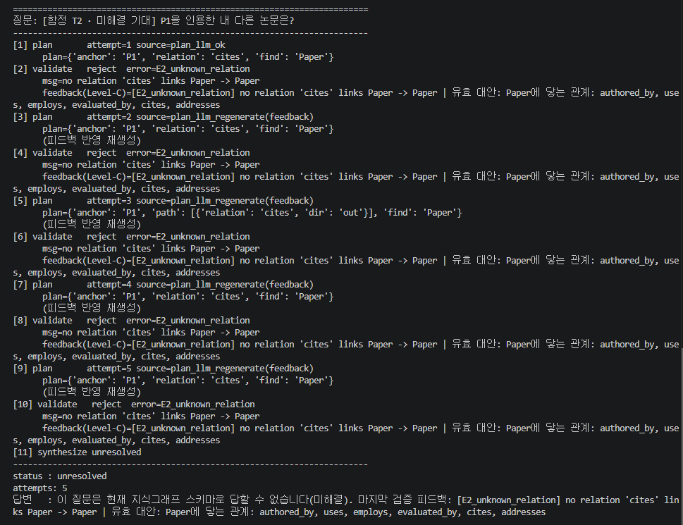

# Self-Correcting GraphRAG Agent

LLM이 생성한 그래프 질의는 틀릴 수 있습니다. 없는 관계를 참조하고, 방향이 반대이고, 존재하지 않는 엔티티를 anchor로 잡습니다.
이 프로젝트는 그 틀린 질의를 결정론적으로 잡아내고, 구조화된 피드백으로 LLM이 스스로 고치게 만드는 자가수정 루프를 구현합니다.

게재 논문 *Improving SQL Generation on Industrial Time-Series Data with Structured EXPLAIN Feedback using a 4B SLM*(Journal of KIIT, 2026)에서
SQL에 적용했던 자가수정 메커니즘을 지식그래프로 이식하고, base SLM(qwen2.5-coder:7b) 위에서 어디까지 되고 어디서 무너지는지를 측정했습니다.

**핵심 결과** (20문항 × 20회 반복, 결정론 채점)

- 검증을 통과하고 답도 맞았지만 추론 경로가 틀린 케이스가 300런 중 40건(13.3%)이었습니다. 검증 통과가 의미적 정답을 보장하지 않습니다.
- base SLM의 자율 4-hop 계획은 3개 모델 모두 0/11이었습니다. 구조화된 다단계 계획에는 태스크 특화 파인튜닝이 필요합니다.
- 피드백 세부도(A/B/C)는 쉬운 교정에서는 차이가 없고 어려운 멀티홉에서는 전부 실패했습니다. 피드백 구조의 이득은 모델 능력이 전제입니다.

개인 프로젝트 · Python · LangGraph · NetworkX · ollama(qwen2.5-coder:7b)

## 왜 만들었나

GraphRAG가 만능은 아닙니다. 단일홉 조회는 일반 RAG로 충분하고, 관계를 두 번 이상 타야 하는 멀티홉 질문에서만 그래프가 의미를 가집니다. 그래서 지식그래프는 제 논문 3편의 교차관계(공유 저자, 공유 데이터 원천, 공유 개념)로 구성해, 멀티홉이 실제로 성립하는 구조를 만들었습니다.

| | 주제 | 메모 |
|---|---|---|
| **P1** | 청년 고립 탐지 (HA-XGB) | LSTM-AE · XGBoost · Shannon 엔트로피 |
| **P2** | 산업 전력 이상탐지 (업종 조건화) | KEPCO-AD 데이터셋 사용 |
| **P3** | SQL 생성 + EXPLAIN 자가수정 (4B SLM) | 이 프로젝트가 이식한 자가수정 메커니즘의 원천 논문 |

논문의 데이터는 국가과제로 다룬 비공개 산업 전력 데이터라, LLM을 로컬 SLM(ollama)으로 돌리는 것은 비용 절감이 아니라 민감 데이터가 외부 API로 나가지 않는 on-premise 환경을 전제한 설계 결정입니다.

핵심 질문은 두 가지였습니다.

- 틀린 그래프 질의를 결정론적으로 잡을 수 있는가?
- 구조화 피드백을 주면 LLM이 실제로 고치는가, 그리고 그 한계는 어디인가?

## 구조



LangGraph `StateGraph`로 네 단계를 연결합니다.

- **plan**: LLM이 자연어 질문에서 `{find, relation, anchor}` 형태의 질의 계획을 생성합니다.
- **validate**: 스키마(노드타입, 관계, 엔티티)를 결정론적으로 검사합니다. 5종 에러(없는 노드타입 / 없는 관계 / 호환불가 / 없는 anchor / 방향오류)를 잡아내고 유효한 대안을 피드백으로 돌려줍니다. 논문에서 EXPLAIN 실행 결과를 피드백으로 쓴 것과 같은 역할입니다.
- **execute**: 검증을 통과한 계획으로 방향 인식 멀티홉 순회를 하고 근거 서브그래프를 수집합니다.
- **synthesize**: 수집된 근거로 답변을 생성합니다.

검증은 스키마만 봅니다. 교정은 LLM이 합니다. 이 분리가 핵심 설계 결정입니다.

| 영역 | 선택 | 이유 |
|---|---|---|
| 에이전트 오케스트레이션 | **LangGraph** | 조건부 분기와 자가수정 루프를 그래프로 명시적으로 표현 |
| 지식그래프 | **NetworkX** | 설치 없이 시작, 스키마 검증 로직에 집중 |
| LLM | **ollama + qwen2.5-coder:7b** | 로컬 실행. 환경변수 하나로 OpenAI API로 전환 가능 |
| 평가 | **결정론 채점** | LLM judge 없이 그래프에서 정답 집합을 도출해 채점 |
| 관측 | **LangSmith** | 환경변수 1개로 단계별 자동 트레이싱 |

## 데모

```bash
python run.py --interactive
```

질문을 직접 입력하면 매 질문마다 plan, validate, execute, synthesize 네 단계가 trace로 펼쳐집니다. 미리 정해진 답을 내는 것이 아니라 계획하고 검증하는 과정이 그대로 보입니다.



```bash
python run.py --demo
```

<table>
<tr>
<td width="50%" valign="top"></td>
<td width="50%" valign="top"></td>
</tr>
<tr>
<td valign="top"><b>자가수정 회복.</b> 의도적으로 방향이 틀린 plan을 주입하면 validate가 <code>E5_wrong_direction</code>을 잡아 유효 대안(<code>dir을 'in'로 변경</code>)을 돌려주고, LLM이 재생성한 plan이 2번째 시도에 통과합니다.</td>
<td valign="top"><b>함정 질문 거부.</b> "P1을 인용한 내 다른 논문은?"에는 함정이 있습니다. 논문 간 <code>cites</code> 관계가 KG에 없으므로 validate가 매 시도마다 거부하고, 5회 소진 후 미해결로 종료합니다.</td>
</tr>
</table>

## 결과

20문항(정상 15 + 함정 5) × 20회 반복, 결정론 채점입니다. 채점에 LLM judge를 쓰지 않았습니다.

| 실험 | 결과 | 의미 |
|---|---|---|
| 단일홉 vs 멀티홉 | 단일홉 6문항 중 5개는 거의 100% 정답. 멀티홉은 문항별로 전부 맞거나 전부 틀리는 all-or-nothing | "2hop 50%" 같은 그룹 평균은 100% 문항과 0% 문항을 섞은 착시 |
| valid ≠ correct | 답은 맞았는데 경로가 틀린 케이스 300런 중 40건(13.3%) | 검증 통과와 정답이 모두 성립해도 추론 경로는 틀릴 수 있음 |
| 함정 질문 | 타입 오류는 즉시 거부. BERT, citation count 같은 함정은 LLM이 스키마에 유효한 형태로 재해석해 우회하기도 함 | 검증기의 설계상 경계(스키마만 본다). 막지 않고 우회율을 그대로 보고 |
| 피드백 세부도 A/B/C | 쉬운 교정은 세부도와 무관하게 전부 회복, 어려운 멀티홉은 세부도와 무관하게 전부 실패 | 논문 결론의 전제조건: 피드백 구조의 이득은 모델이 그 태스크를 해낼 능력이 있을 때만 발현 |
| 멀티홉 자율계획 M4 | 경로를 직접 주입하면 결정론적으로 정답. base 모델의 자율 4-hop 계획은 0/11 (qwen2.5-coder:7b, qwen2.5:7b-instruct, qwen3.6:35b) | 구조화 다단계 계획에는 태스크 특화 파인튜닝이 필요 |

가장 흥미로운 발견은 valid ≠ correct입니다. 예를 들어 "이상금이 쓴 논문의 방법은?"이라는 질문에서 LLM이 anchor를 손병훈으로 잘못 잡는데, 두 사람이 같은 논문을 공저했으므로 답이 우연히 일치합니다. 논문에서 말한 FCR(구문 유효성) ≠ 의미적 정답을 그래프 도메인에서 정량화한 것입니다.

피드백 세부도 실험은 논문의 결론을 뒤집은 것이 아니라 전제를 찾은 것입니다. 논문에서는 파인튜닝된 4B 모델로 피드백이 세부적일수록 수렴이 빨라지는 것을 보였는데, base SLM에서는 그 이득이 나타나지 않았습니다. 그 경계가 파인튜닝입니다.

## 결과를 읽을 때 유의할 점

- base SLM의 멀티홉 능력에 절벽이 있습니다. 에이전트 성능을 자랑하는 것이 아니라 한계를 측정한 것입니다.
- 논문의 파인튜닝 모델은 SQL 태스크 특화라 KG 계획 측정에는 부적합합니다. 깨끗한 비교에는 KG 특화 LoRA가 필요합니다.
- KG가 작고, valid ≠ correct 수치는 저자 집합의 구조에 의존합니다.
- 20문항 × N=20은 정성적 경향까지만 보여 줍니다. 통계적 유의성은 더 큰 평가셋의 몫입니다.

## 실행

- Python 3.10+
- [ollama](https://ollama.com/) + `qwen2.5-coder:7b` 모델 (`ollama pull qwen2.5-coder:7b`), 또는 OpenAI API 키 (`LLM_BACKEND=openai`, `LLM_MODEL=gpt-4o` 등)

```bash
python -m venv .venv
.venv\Scripts\pip install -r requirements.txt   # Windows
.venv/bin/pip install -r requirements.txt       # Linux/Mac
```

```bash
python run.py                # 질문 하나 end-to-end
python run.py --demo         # 자가수정 회복 + 함정 거부 시연
python run.py --interactive  # 대화형 모드 (직접 질문 입력)
python run.py --m4           # 멀티홉 엔진 증명 + base SLM 한계
python run.py --abc          # 피드백 세부도 A/B/C 실험
python eval/run_eval.py 20   # 평가셋 전체 (N=20)
```

`LANGCHAIN_TRACING_V2=true`와 API 키만 설정하면 LangGraph가 각 단계를 자동 트레이싱합니다. 자가수정 케이스에서 초기 plan(`anchor: KEPCO`)과 재생성 plan(`anchor: KEPCO-AD, dir: in`)이 실제로 달라지는 것을 trace로 확인할 수 있습니다. 교정을 결정론적 repair 함수가 아니라 LLM이 재계획으로 수행한다는 증거입니다.

<details>
<summary>파일 구조</summary>

```
run.py              CLI 진입점 (데모, 대화형, 실험 모드)
agent.py            LangGraph 자가수정 루프
knowledge_graph.py  KG 검증 + 멀티홉 실행
kg_data.py          논문 3편 기반 KG 온톨로지·데이터
planner.py          자연어 → 질의 계획 (LLM + 폴백)
synthesize.py       서브그래프 근거 기반 답변 생성
llm.py              교체형 LLM 백엔드
eval/               평가셋, 채점기, 실험 로그
```

</details>

## 관련 논문

- **P3** · B. Son, M. Jung, S. Lee, *Improving SQL Generation on Industrial Time-Series Data with Structured EXPLAIN Feedback using a 4B SLM*, Journal of KIIT, Vol.24, No.7, 2026. [DOI](https://doi.org/10.14801/jkiit.2026.24.7.81) · 이 프로젝트가 이식한 자가수정 메커니즘의 원천
- **P3 영문 확장** · B. Son et al., *Structured EXPLAIN Feedback Improves SQL Generation with a 4B SLM on Industrial Time-Series Data*, AIDataSci @ KDD 2026 (Poster)
- **P2** · 손병훈 외, *한국 산업 전력 이상 탐지를 위한 업종 조건화 전략의 예비 비교: 설계 및 예비 분석*, 한국통신학회 2026년도 하계종합학술발표회 (구두 발표)
- **P1** · 손병훈 외, *통신 메타데이터의 엔트로피 분석과 하이브리드 딥러닝 기반 청년 고립 탐지*, 한국통신학회 2026년도 동계종합학술발표회 (포스터 발표)
